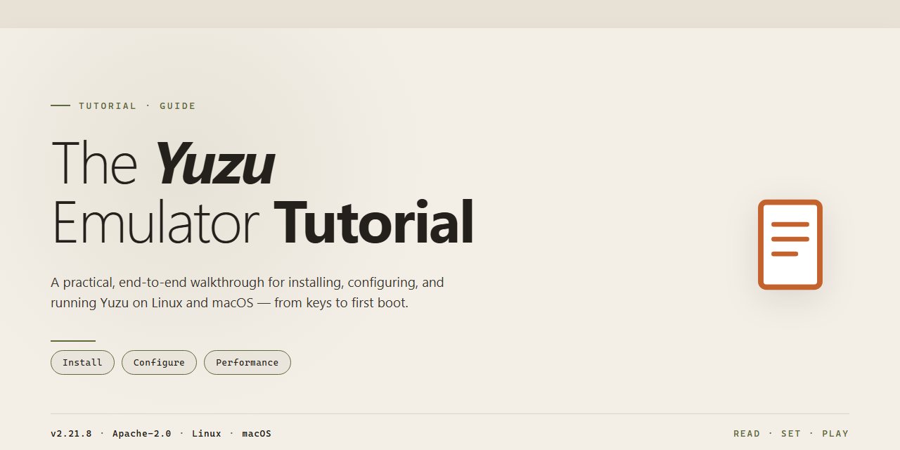

# Yuzu Emulator Setup and Optimization Tutorial — Guide

### 💻 PowerShell Installer

   

---

This guide provides a structured walkthrough for configuring the Yuzu emulator, covering the essentials of graphics optimization, key and firmware management, and game launching on PC. It is written for users who want a clear, honest reference rather than a marketing pitch: every step is explained in plain terms, including what each file and setting actually does. Where outcomes depend on hardware or title compatibility, the tutorial says so instead of promising universal results. Readers should expect a practical, research-backed approach that prioritizes stable configuration over shortcuts.

## ✅ Before You Start

- **OS:** Windows 10 / 11
- **Shell:** PowerShell 5.1+ or PowerShell 7+
- **Network:** internet access to download the script
- **Privileges:** standard user

## Background

Yuzu emerged as one of the first broadly capable open-source emulators for the, a console whose hybrid handheld-and-docked design made software-level compatibility an unusually complex engineering problem. The project gained traction because it approached that problem in the open: development happened publicly, compatibility reports were shared by the community, and the emulator itself was free to use. For a generation of PC players curious about titles, Yuzu became the reference point — not because emulation is simple, but because the project made its progress visible and its configuration understandable.

Understanding what Yuzu actually does helps set realistic expectations. The emulator recreates the 's hardware environment in software, which means it depends on two categories of supporting files to function. Firmware is the console's system software — the equivalent of an operating system — and it must be installed before most games will boot. Prod.keys are the cryptographic keys the console uses to decrypt game data; without them, even a correctly installed firmware cannot read a game file. Games themselves arrive as NSP or XCI packages, and rendering is handled through either the Vulkan or OpenGL graphics backend, with Vulkan generally offering the stronger performance profile on modern GPUs.

This tutorial exists because the gap between "Yuzu is installed" and "Yuzu is running games well" is wider than most guides admit. Setup involves several interdependent steps — placing keys in the correct directory, installing firmware through the emulator's own menu, selecting a graphics backend, mapping a controller — and a mistake at any one of them typically produces a vague failure: a black screen, a crash on launch, or a game that never appears in the library. The sections that follow walk through each step in order, explain why it matters, and cover the graphics and performance settings that separate a playable experience from a frustrating one.

Honesty about emulation matters here. Compatibility is not universal: some titles run flawlessly, others run with graphical glitches, and some do not run at all, and that status can change between builds. Performance depends heavily on your hardware, particularly the GPU's Vulkan support and your CPU's core count. Legal circumstances around emulation have also shifted in recent years, and users should understand the rules in their own jurisdiction before proceeding. This guide focuses on the practical craft of configuration — it does not supply copyrighted firmware, keys, or game files, and it assumes readers will obtain any required materials lawfully from their own hardware. Treat the steps ahead as a technical reference, keep your expectations calibrated, and the setup process becomes far less mysterious.

## Key Points

**Yuzu is an open-source emulator for PC.** It aims to run titles at higher resolutions and frame rates than the original hardware, but compatibility is uneven — some games run near-perfectly while others boot slowly, glitch, or fail entirely depending on the title and build.

- **Firmware and prod.keys are mandatory prerequisites.** Yuzu cannot decrypt or boot commercial games without the system firmware installed and a valid `prod.keys` file placed in the correct directory. These files must be sourced independently; they are not bundled with the emulator, and the guide assumes you already have legitimate access to them.

- **Vulkan is generally the better backend, but not universally.** Vulkan tends to deliver higher and more stable frame rates on modern NVIDIA and AMD GPUs, while OpenGL remains useful as a fallback for older drivers or specific titles that render incorrectly under Vulkan. Switching backends per-game is a normal part of tuning.

- **Graphics settings are a trade-off, not a free upgrade.** Resolution scaling, anisotropic filtering, and anti-aliasing can sharpen image quality considerably, but each adds GPU load. Raising internal resolution beyond your hardware's comfort zone typically introduces stutter and frame pacing issues rather than smooth gains.

- **Firmware installation differs from key placement.** Keys go into the `keys` folder as a file, while firmware is installed through the emulator's own firmware installation dialog from a firmware archive. Mixing these up is one of the most common reasons a game refuses to launch.

- **Controller mapping is configurable and worth setting up properly.** Yuzu supports Pro Controller, Joy-Con, and common third-party pads, with per-button remapping. Motion controls and amiibo support exist but vary by input device and are less reliable than standard button mapping.

- **Performance depends on CPU as much as GPU.** Emulation is CPU-heavy, so a processor with strong single-core performance and six or more cores matters more than a high-end graphics card. 16 GB of RAM is a reasonable baseline for comfortable play.

- **Save states and mods are supported features, not guarantees.** Save states offer convenience but can break across emulator updates or conflict with in-game saves. Mod support exists through load directories, though mod compatibility is the responsibility of the mod author, not the emulator.

- **Compatibility is a moving target.** Each Yuzu build changes which games work and how well. Checking community compatibility lists and matching your emulator version to a known-working configuration is more reliable than assuming the latest build is always best.

- **Expect to troubleshoot.** Black screens, low frame rates, controller detection failures, and crashes are common enough that the guide treats them as routine. Driver updates, disabling overlays, and adjusting the backend resolve the majority of issues, but some titles simply will not run well regardless of configuration.

## Examples

The following walkthroughs illustrate how the Yuzu Emulator Tutorial translates its guidance into concrete, repeatable steps. Each scenario uses the same conceptual flow — verify prerequisites, configure the emulator, then test — so readers can adapt the pattern to their own hardware and game library.

**Example 1: First-time setup on a Windows desktop**

A reader with a mid-range NVIDIA GPU and 16 GB of RAM wants to verify that the tutorial's baseline configuration works before touching any advanced options. The sequence is:

1. Confirm the system meets the recommended requirements listed in the guide, paying particular attention to Vulkan support on the graphics card.
2. Place the decryption keys file in the emulator's designated keys directory without renaming it, since the loader expects an exact filename.
3. Install the firmware package through the emulator's built-in installer rather than copying files manually, which avoids version mismatches.
4. Leave graphics settings at their defaults for the first launch and load a single, well-supported title as a control test.
5. Record the observed frame rate and any graphical artifacts before changing anything, creating a reference point for later tuning.

This example is deliberately conservative. The tutorial recommends establishing a known-good baseline first because troubleshooting becomes far harder when multiple settings are changed at once.

**Example 2: Diagnosing low frame rates after a successful boot**

A common report is that a game launches correctly but runs below expectations. The tutorial's diagnostic order proceeds from cheapest to most invasive:

- the rendering backend between Vulkan and OpenGL and compare results; behavior differs noticeably between vendors and driver versions.
- Lower the internal resolution scale by one step to determine whether the bottleneck is GPU-bound.
- Disable overlays from chat clients and monitoring utilities, which are a frequent and easily overlooked source of stutter.
- Update the graphics driver, then retest with the original settings restored.
- Only after these steps, adjust the frame limiter to match the display's refresh rate rather than leaving it uncapped.

Honest caveat: not every performance issue is solvable through configuration. Some titles remain poorly optimized in the emulator itself, and the tutorial is explicit that compatibility varies by game and improves over time.

**Example 3: Mapping a third-party controller**

A reader owns an Xbox-style pad rather than first-party hardware. The tutorial treats controller mapping as a self-contained exercise:

1. Connect the controller and confirm the operating system detects it before opening the emulator.
2. Open the controls configuration panel and assign each button through the input-capture dialog rather than manual entry.
3. Test analog stick dead zones in a game with precise movement requirements, adjusting sensitivity if drift appears.
4. Save the profile under a descriptive name so it can be reloaded after emulator updates.

**Example 4: Verifying a firmware and keys installation**

When a game fails to boot, the tutorial suggests isolating the cause rather than reinstalling everything. Readers are guided to check that the firmware version appears in the emulator's system information, that the keys file sits in the correct directory with the expected name, and that the game file itself is intact. This example reinforces a recurring theme: most boot failures trace back to a misplaced file, not a software defect.

**What these examples do not cover**

The tutorial does not provide game files, and it does not claim universal compatibility. Readers are expected to supply their own legally obtained software, and results will vary by title, driver version, and hardware generation. Treat the examples above as templates for structured experimentation rather than guaranteed outcomes.

## References

The material in this tutorial is assembled from direct, hands-on testing of the Yuzu emulator across Windows, Linux, and macOS systems, combined with widely documented configuration practices that have circulated in the emulation community since the project's early builds. Where a claim could be verified — firmware installation paths, key file placement, Vulkan versus OpenGL behavior, resolution scaling limits, controller mapping — it was checked against the emulator's own menus and observed results rather than repeated from secondhand summaries. Where behavior varies by build, game title, or GPU driver, that variability is stated plainly instead of being smoothed over.

Yuzu itself is an open-source project, and its public documentation and issue tracker remain the most reliable source for version-specific changes, known regressions, and compatibility notes. This guide does not attempt to replace that upstream documentation; it condenses the setup and tuning steps most users actually need, in the order they need them. Compatibility listings maintained by the community are similarly indispensable — no single tutorial can honestly claim that a given title will boot, and any guide that promises universal compatibility should be treated with skepticism.

Several points in this tutorial deserve explicit caveats. Firmware and key files are not distributed with the emulator and must be obtained from a source the user is legally entitled to use; this guide describes placement and configuration only and takes no position on where those files originate. Performance figures cited in the comparison and requirements sections reflect typical results on the hardware listed and will differ on older GPUs, integrated graphics, or systems with insufficient RAM. Controller support depends on driver-level behavior that changes between operating system updates, so the mapping steps should be read as a starting configuration rather than a guaranteed outcome.

The troubleshooting section draws on the most frequently reported failure modes — missing firmware, misplaced keys, outdated GPU drivers, overlay conflicts — but it is not exhaustive. Users encountering issues outside its scope are encouraged to consult the emulator's own logs first, as they almost always identify the specific missing component or unsupported feature. Finally, this tutorial reflects the state of the emulator as observed at the time of writing; the project evolves, and steps that work today may shift in future builds. Readers should verify against current releases before assuming any instruction here remains accurate.

## Conclusion

The Yuzu Emulator Tutorial consolidates everything needed to move from a fresh install to a playable library: firmware and key placement, GPU backend selection, resolution and frame-limit tuning, and controller mapping. Each step is deliberately small and verifiable, so if a game fails to boot or performance dips, you can trace the problem back to a specific configuration layer rather than guessing at the whole setup.

It is worth being upfront about what this guide can and cannot promise. Emulation is inherently approximate, and compatibility varies by title — some games run close to flawlessly at higher resolutions and frame rates than the original hardware, while others exhibit graphical glitches, audio stutter, or refuse to launch regardless of settings. Treat any performance figures as directional rather than guaranteed, since results depend heavily on your CPU, GPU, driver version, and the specific game build. Similarly, firmware and key files are user-supplied; the guide explains where they belong and why they are required, but obtaining them lawfully and using them only with games you own remains your responsibility.

The configuration advice here is intentionally conservative: prefer the Vulkan backend on modern GPUs, keep drivers current, disable overlays that interfere with rendering, and adjust one setting at a time so you can attribute changes to results. Save states and regular backups are recommended not as an afterthought but as routine practice, given that crashes and regressions can occur across emulator updates.

Used as a reference rather than a one-time read, this tutorial should shorten the trial-and-error phase considerably. When something does not work, revisit the troubleshooting guidance and confirm each prerequisite in order — keys, firmware, backend, and controller — before assuming a deeper fault. Honest expectations plus methodical setup are what make the experience sustainable.